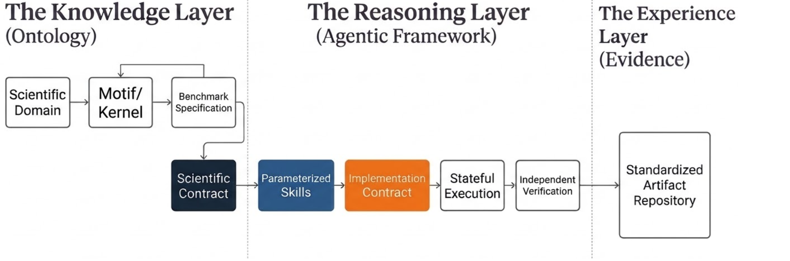

# DeepVELA-Repro

Agent skills for benchmark reproduction with Claude Code and Codex. A coding agent that follows these skills prepares, runs, repairs, and verifies a benchmark from its task prompt and repository documentation, and writes a measured report. The skills are written for researchers who reproduce a benchmark on their own hardware.



The architecture has three layers. The knowledge layer holds the benchmark ontology: scientific domain, motif or kernel, and benchmark specification, which together yield a scientific contract. The reasoning layer is the agentic framework that turns the contract into parameterized skills, an implementation contract, stateful execution, and independent verification. The experience layer stores the resulting evidence in a standardized artifact repository.

## Contents

- [Configurations](#configurations)
- [Install](#install)
- [What you provide](#what-you-provide)
- [What a run produces](#what-a-run-produces)
- [Scoring a benchmark with the builder](#scoring-a-benchmark-with-the-builder)
- [Repository layout](#repository-layout)

## Configurations

| Configuration | Claude Code | Codex |
| --- | --- | --- |
| Reproduce (Skill-guided) | [Reproduce](skills/claude/reproduce/SKILL.md) | [Reproduce](skills/codex/reproduce/SKILL.md) |
| Builder + Reproduce | [Builder + Reproduce](skills/claude/builder-reproduce/SKILL.md) | [Builder + Reproduce](skills/codex/builder-reproduce/SKILL.md) |

**Reproduce** follows the declared workload through preparation, preflight,
execution, repair, verification, and reporting. **Builder + Reproduce** first
constructs a source-grounded benchmark contract and assesses reference quality
against the MLCommons ontology, then hands that contract to Reproduce.
Reference-quality scores and reproduction agreement are separate assessments.

Use Reproduce when the benchmark already documents its task, data, metric, and evaluator. Use Builder + Reproduce when that contract is missing or spread across a paper, code, data, and results.

The Claude and Codex packages differ in the hand-off wording of `builder-reproduce`, and the Codex `reproduce` package omits two rules that the Claude package has: sampling every sub-workload in the bounded preflight run, and validating a throughput, batching, memory, or output change on a bounded run before a full run. Compare the two `SKILL.md` files before assuming the agents behave the same.

## Install

Choose the packages for your agent. Install `reproduce` for Skill-guided.
For Builder + Reproduce, install both `builder-reproduce` and `reproduce` from
the same agent directory. The builder package contains the ontology reference,
rubric, templates, and scoring scripts; the reproduction procedure is shared
with the standalone Reproduce configuration.

- Claude Code: place the selected folders under your project's `.claude/skills/`.
- Codex: place the selected folders under your project's `.agents/skills/`.

Invoke `reproduce` for reproduction alone. For Builder + Reproduce, invoke
`builder-reproduce`, request the ontology assessment and score, and continue
with `reproduce` in the same session. Builder scoring requires Python 3 and
PyYAML (`python -m pip install pyyaml`).

## What you provide

The skills do not contain benchmark-specific or hardware-specific commands. You supply them in three places.

**Task prompt.** The prompt is the run contract. The agent does not reopen anything the prompt fixes. State, at least:

| Field | Meaning |
| --- | --- |
| Benchmark and target | the benchmark, and each target (one terminal evaluator invocation) to reproduce |
| Source revision | the commit to pin |
| Inputs and cache | dataset, checkpoint, and cache locations |
| Metric | the metric and the evaluator that computes it |
| Resources and budget | cores, accelerators, memory, and the time limit |
| Compute rule | where each kind of work runs, and what must run one at a time |
| Layout and report | the workspace layout and the exact `report.json` the agent must write |
| Human replies | whether a human will answer questions during the run |

The last field decides how the agent handles a blocked or unclear step. If a human will reply, the agent stops and asks. If none will, the agent records what it measured in `report.json`, states the failure with its evidence, and stops work on that target.

**Hardware and scheduler (`docs/local-preferences.md`).** If the workspace has this file, the agent reads it. It holds the execution target (local or scheduler, plus account, partition, reservation, GPU string, and wall time), the environment strategy (documented route, modules first, container as fallback), and cache and download paths. If a value is missing, the agent asks once and writes the answer back. It never guesses an account, partition, reservation, or cache path. The file holds no task facts such as revision, target, or metric.

**Benchmark card (`BENCHMARK_CARD.md`).** If the workspace has one, the agent reads it for the task, data, metrics, evaluator, and reference command, each with its source. Builder + Reproduce writes this file. A conflict between the card, the prompt, and the source is reported with its evidence.

## What a run produces

Inside the workspace, the agent creates:

```text
./                  workspace
├── repo/           pinned source
├── reproduce.sh    written during preflight, run unchanged for the full run
├── <target id>/    multi-target tasks only; each holds that target's out/ directory
├── plan.md         the plan for the full run, updated on each re-plan
└── report.json     measured results in the format the prompt requires
```

`reproduce.sh` accepts `--stage <name>` to run one stage alone (environment build, input download and preprocessing, accelerator run). With no `--stage`, it runs every stage under the prompt's compute rule, as a grader would. `reproduction.md` and `effect_ledger.jsonl` are written only when requested, to support resuming and auditing long runs.

The agent measures through the benchmark-owned evaluator and does not score its own result.

## Scoring a benchmark with the builder

`builder-reproduce` includes a rubric template for the six categories of the MLCommons Science Benchmarks Ontology (arXiv:2511.05614) and a scorer.

1. Copy `assets/rubric_template.yaml` beside the benchmark.
2. Set `met` to `true` or `false` for every item, with the file and section that supports it in `evidence`. Leave `null` only for an item you have not answered.
3. Run the scorer from the builder skill directory:

```bash
python scripts/score_benchmark.py path/to/rubric.yaml --out SCORE_REPORT.md
```

The scorer refuses to score a category that has unanswered items. A score of 4.5 or higher is the endorsement threshold the scorer reports against.

## Repository layout

```text
skills/
  claude/reproduce/            Reproduce package for Claude Code
  claude/builder-reproduce/    Builder + Reproduce package for Claude Code
  codex/reproduce/             Reproduce package for Codex
  codex/builder-reproduce/     Builder + Reproduce package for Codex
  SOURCES.json                 package names, changes from the source skills, and file digests
docs/images/                   figures used in this README
```
