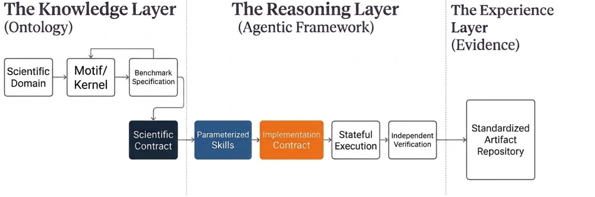

# DeepVELA-Repro

Agent skills for benchmark reproduction with Claude Code and Codex. A coding agent that follows these skills prepares, runs, repairs, and verifies a benchmark from its task prompt and repository documentation, and writes a measured report. The skills are written for researchers who reproduce a benchmark on their own hardware. A harness sets up MLPerf Inference tasks, starts comparable runs with and without the skills, and scores each finished run against a rubric and a reference.



The architecture has three layers. The knowledge layer holds the benchmark ontology: scientific domain, motif or kernel, and benchmark specification, which together yield a scientific contract. The reasoning layer is the agentic framework that turns the contract into parameterized skills, an implementation contract, stateful execution, and independent verification. The experience layer stores the resulting evidence in a standardized artifact repository.

## Contents

- [Configurations](#configurations)
- [Get started](#get-started)
- [What the reproducing agent reads](#what-the-reproducing-agent-reads)
- [What a run produces](#what-a-run-produces)
- [Scoring a benchmark with the builder](#scoring-a-benchmark-with-the-builder)
- [C0–C6 masking conditions](#c0c6-masking-conditions)
- [Repository layout](#repository-layout)

## Configurations

| Configuration | Claude Code | Codex |
| --- | --- | --- |
| Reproduce (Skill-guided) | [Reproduce](skills/claude/reproduce/SKILL.md) | [Reproduce](skills/codex/reproduce/SKILL.md) |
| Builder + Reproduce | [Builder + Reproduce](skills/claude/builder-reproduce/SKILL.md) | [Builder + Reproduce](skills/codex/builder-reproduce/SKILL.md) |

**Reproduce** follows the declared workload through preparation, preflight,
execution, repair, verification, and reporting. **Builder + Reproduce** first
constructs a source-grounded benchmark contract and assesses reference quality
against the MLCommons ontology, then hands that contract to Reproduce.
Reference-quality scores and reproduction agreement are separate assessments.

Use Reproduce when the benchmark already documents its task, data, metric, and evaluator. Use Builder + Reproduce when that contract is missing or spread across a paper, code, data, and results.

The Claude and Codex packages contain the same procedure. They differ only in how `builder-reproduce` hands off to `reproduce`: Claude Code calls the Skill tool, and Codex loads the installed `reproduce` skill in the same session.

## Get started

1. Clone this repository, install the harness dependencies, and open Claude Code or Codex in its root:

   ```bash
   python -m pip install -r requirements.txt
   ```

   The harness skill, [`agent-evaluation-profile`](skills/agent-evaluation-profile/SKILL.md), loads from `.claude/skills/` and `.agents/skills/`. Do not install the Reproduce skills at user level: a user-level copy reaches every arm, including `plain`.

2. Ask the agent to reproduce a task, for example:

   ```text
   Reproduce mlperf-language-bert with the three arms.
   ```

   The task is a record in [`dataset/tasks/`](dataset/tasks/) or a link to a new benchmark repository. Answer the agent's questions. The first time, it asks for your deployment answers (where bundles and runs live, whether runs use this machine or Slurm, the model, and whether a human will answer during runs) and saves them in [`docs/local-preferences.md`](docs/local-preferences.md). For a new task, it asks you to choose targets, the reference and tolerance for each result, and a time limit, and writes the rubrics from those answers.

3. The agent sets up the task and prepares one workspace per arm (`plain`, `skill`, `builder-skill`). It starts the arms it can start itself. For any other arm, it gives you a path ending in `ws/`. Open exactly that `ws/` directory as the workspace of a new editor window, start a new chat there, and paste the text of `ws/prompt.md` unchanged. Do not open the run directory above `ws/` or any other parent: that session would see `launch.json` and other runs, and the evaluation counts it as a wrong launch.

4. When a run ends, tell the agent in the repository chat. It freezes the run, scores it against the task's rubric, and reports the result. Each workspace also holds `report.json` (the evaluator's values), `reproduce.sh` (the delivered script), `plan.md`, and the logs under `<target id>/out/`.

To use the Reproduce skills in a workspace of your own instead, ask the agent here to install them there; it copies `skills/claude/<package>` to `.claude/skills/` or `skills/codex/<package>` to `.agents/skills/`. The prompt you then send in that workspace starts with `/reproduce` (or `/builder-reproduce`) and states the run contract in [What the reproducing agent reads](#what-the-reproducing-agent-reads).

## What the reproducing agent reads

<details>
<summary>Show details</summary>

The skills contain no benchmark-specific or hardware-specific commands. The agent in an arm's workspace takes them from up to three inputs. With the harness you write none of them: the harness renders the prompt from the dataset record and your answers, and Builder + Reproduce writes the card. You write a prompt only when you use the skills in a workspace of your own.

**Task prompt (`prompt.md`).** The prompt is the run contract. The agent does not reopen anything the prompt fixes. It states:

| Field | Meaning |
| --- | --- |
| Benchmark and target | the benchmark, and each target (one terminal evaluator invocation) to reproduce |
| Source revision | the commit to pin |
| Inputs and cache | dataset, checkpoint, and cache locations |
| Metric | the metric and the evaluator that computes it |
| Resources and budget | cores, accelerators, memory, and the time limit |
| Compute rule | where each kind of work runs, and what must run one at a time |
| Layout and report | the workspace layout and the exact `report.json` the agent must write |
| Human replies | whether a human will answer questions during the run |

The last field decides how the agent handles a blocked or unclear step. If a human will reply, the agent stops and asks. If none will, the agent records what it measured in `report.json`, states the failure with its evidence, and stops work on that target.

**Benchmark card (`BENCHMARK_CARD.md`).** Builder + Reproduce writes this card before reproducing. It states the task, data, metrics, evaluator, and reference command, each with its source. Reproduce reads it, and reports a conflict between the card, the prompt, and the source with its evidence.

**Workspace preferences (`docs/local-preferences.md` inside the workspace).** Optional, and only for a workspace of your own: harness-prepared workspaces do not have one, because the prompt states the compute rule. If the file exists, Reproduce reads the execution target, environment strategy, and cache paths from it, asks once for any missing value, and writes the answer back. It never guesses an account, partition, reservation, or cache path. This file is separate from the harness's [`docs/local-preferences.md`](docs/local-preferences.md) in this repository.

</details>

## What a run produces

<details>
<summary>Show details</summary>

After a run, the workspace holds:

```text
./                  workspace
├── prompt.md       the task prompt (harness-prepared workspaces)
├── tasks.json      per-target records the prompt points to (harness-prepared workspaces)
├── repo/           pinned source
├── reproduce.sh    written during preflight, run unchanged for the full run
├── <target id>/    multi-target tasks only; each holds that target's out/ directory
├── plan.md         the plan for the full run, updated on each re-plan
└── report.json     measured results in the format the prompt requires
```

`reproduce.sh` accepts `--stage <name>` to run one stage alone (environment build, input download and preprocessing, accelerator run). With no `--stage`, it runs every stage under the prompt's compute rule. `reproduction.md` and `effect_ledger.jsonl` are written only when requested, to support resuming and auditing long runs.

The agent measures through the benchmark-owned evaluator and does not score its own result.

</details>

## Scoring a benchmark with the builder

<details>
<summary>Show details</summary>

`builder-reproduce` rates a benchmark's documentation against the six categories of the MLCommons Science Benchmarks Ontology (arXiv:2511.05614). It does not score a reproduction run; the harness does that separately, against the task's rubric and reference. The `builder-skill` arm does this before reproducing: the agent fills the rubric from the benchmark's sources, writes `rubric.yaml`, runs the bundled scorer, and leaves `BENCHMARK_CARD.md` and `SCORE_REPORT.md` in the workspace. To rate a benchmark on its own, ask the agent, for example `Assess <benchmark repository> against the MLCommons ontology`.

`SCORE_REPORT.md` gives a score per category, with the evidence for each rubric item. A category with unanswered items is not scored, and 4.5 is the endorsement threshold the report compares against.

</details>

## C0–C6 masking conditions

The controlled masking studies run one reproduction target under seven source conditions: Chronos-2 on GIFT-Eval (time-series forecasting) and 3D U-Net on MLPerf Inference (medical imaging). Each condition starts from the full reference source (C0), removes the information of one category of the MLCommons reference-quality rubric, and leaves the reproduction target, inputs, and evaluator unchanged. The score is the overall MLCommons rubric score of the masked reference, out of five; a lower score marks a less complete reference. The 3D U-Net task record is [`dataset/tasks/mlperf-c0-c6/3d-unet-kits19.json`](dataset/tasks/mlperf-c0-c6/3d-unet-kits19.json).

The conditions test one hypothesis: an agent can recover information that belongs to the implementation contract, $I$, from the remaining sources and the environment, but cannot recover a value that belongs to the scientific contract, $S$, without inventing it. The last column marks the conditions that remove a value in $S$.

| Condition | Rubric category | GIFT-Eval (Chronos-2): removed information | Score | MLPerf (3D U-Net): removed information | Score | Value in $S$ |
| --- | --- | --- | --- | --- | --- | --- |
| C0 | None | None | 4.5 | None | 4.4 | No |
| C1 | Software environment | Setup and installation instructions | 4.3 | Container specification with version pins; build and setup recipes | 3.8 | No |
| C2 | Problem specification | Choice of native multivariate or flattened univariate inputs | 4.3 | Target voxel spacing for resampling every scan; published scores | 3.9 | Yes |
| C3 | Dataset | Evaluated dataset revision and source lineage | 4.3 | KiTS19 download links and instructions | 4.0 | No |
| C4 | Performance metrics | Quantile grid for the approximate CRPS (continuous ranked probability score) | 4.3 | How per-scan Dice scores, including failed scans, combine into the reported score; published scores | 4.0 | Yes |
| C5 | Reference solution | Published evidence of secondary-metric evaluation | 4.3 | Inference harness that runs the model under LoadGen | 3.9 | No |
| C6 | Documentation | Benchmark motivation and rationale | 4.3 | Overview, background, and motivation | 3.7 | No |

## Repository layout

<details>
<summary>Show details</summary>

```text
skills/
  claude/reproduce/            Reproduce package for Claude Code
  claude/builder-reproduce/    Builder + Reproduce package for Claude Code
  codex/reproduce/             Reproduce package for Codex
  codex/builder-reproduce/     Builder + Reproduce package for Codex
  agent-evaluation-profile/    harness skill: set up a task and prepare each arm's workspace
  SOURCES.json                 package names, the agent each targets, and file digests
.claude/skills/, .agents/skills/   links that load the harness skill in this repository
evaluation/                    task_prompt.py (render prompts), bundle.py (seal bundles), prepare.py (build arm workspaces), launch.py (start and freeze runs), scorer.py, checkers.py, transcript.py, schema.py (score a frozen run)
dataset/tasks/                 MLPerf Inference task records
docs/local-preferences.md      deployment answers, filled by the agent on first use
docs/dataset-schema.md         task record format
docs/images/                   figures used in this README
tests/                         harness tests (python -m pytest tests)
```

</details>
